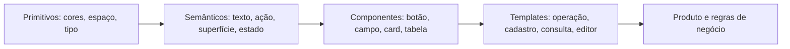

# Fundamentos do Yooga Design System

Especificação v1.0.0. Origem e evidências: [inventário](EVIDENCE.md). **Todas as regras de uso abaixo são propostas normativas para projetos futuros**. Os valores identificados como C foram confirmados nos estilos públicos da Yooga; isso não equivale a uma auditoria de todas as telas.

## 1. Identidade de experiência

**Clara, próxima, organizada e operacional.** A interface deve permitir que a pessoa reconheça o que está vendo, encontre a próxima ação e compreenda o resultado. O visual transmite leveza com superfícies claras e formas suaves, mantendo precisão em dados e decisões.

| Princípio                | Tradução prática                                               | Critério de revisão                                            |
| ------------------------ | -------------------------------------------------------------- | -------------------------------------------------------------- |
| A tarefa vem primeiro    | Ação principal junto ao conteúdo relevante                     | A pessoa encontra a próxima ação sem percorrer menus distantes |
| Reconhecimento rápido    | Ícone + rótulo; imagens onde distinguem objetos                | A operação não depende de decorar símbolos                     |
| Contexto contínuo        | Resumo, seleção e orientação preservados                       | Abrir um detalhe não perde filtros ou trabalho                 |
| Complexidade progressiva | Ferramentas avançadas em áreas secundárias                     | O caminho comum tem pouca competição visual                    |
| Feedback proporcional    | Resultado local para ação local; modal para decisão necessária | Toda ação produz feedback sem interrupções excessivas          |
| Consistência sem rigidez | Mesmos componentes, templates adequados à tarefa               | Cadastro não precisa imitar um PDV                             |
| Legibilidade operacional | Contraste, hierarquia e áreas de toque generosas               | A aparência funciona em uso repetitivo e em celular            |
| Recuperação previsível   | Preservar entrada e explicar como continuar                    | Erros não obrigam a recomeçar                                  |

## 2. O que permanece e o que pode variar

**Núcleo:** Poppins, família de azuis Yooga, superfícies claras, escala tipográfica, raios, espaçamento, semântica de cores, componentes básicos, voz e acessibilidade.

**Adaptável:** largura de conteúdo, densidade, composição, navegação global, uso de imagens, quantidade de colunas e módulos de domínio.

**Extensões:** mapa de mesas, canvas, KDS, gráficos especializados, agendamento, checkout e qualquer objeto próprio do negócio. Devem herdar o núcleo e registrar estados e interações específicos.

Não transportar nomes como Cliente, Vendedor, Caixa ou Pagamento para um produto que gerencia projetos ou arquivos. Transportar a relação: coleção → seleção → contexto → ação → feedback.

## 3. Arquitetura de tokens

Usar tokens semânticos em componentes. Primitivos descrevem valores; semânticos descrevem intenção. Uma cor de status “pago” não deve ser reutilizada para “salvar” só porque ambos parecem positivos.

O arquivo [tokens.json](tokens.json) usa formato próprio: folhas têm `type`, `value`, `origin` e, quando útil, `description`. Referências usam `{caminho.do.token}`. Dimensões possuem unidade explícita. Não reivindica compatibilidade automática com ferramentas de tokens. No Touch Draw, `scripts/generate-design-tokens.mjs` resolve aliases e gera variáveis CSS no build; a tipografia é aplicada em rem na interface. Não há carregamento do JSON em runtime. Outras plataformas precisam de adaptadores próprios.

## 4. Cor

### 4.1 Paleta de identidade confirmada

| Papel original     | Valor                 | Origem                    | Uso no sistema proposto                      |
| ------------------ | --------------------- | ------------------------- | -------------------------------------------- |
| Azul de marca      | `#19A1E6`             | C `--yoo-primary`         | Logotipo, detalhes e ilustração              |
| Azul 100           | `#E1F1FD`             | C                         | Seleção e informações suaves                 |
| Azul 300           | `#83CEF6`             | C                         | Botão primário suave                         |
| Azul 500           | `#0A639A`             | C                         | Botão sólido e links                         |
| Azul 600           | `#0D547F`             | C                         | Texto sobre azul suave; hover de ação        |
| Azul mais escuro   | `#085278`             | C `--yoo-primary-darker`  | Pressionado                                  |
| Azul de foco       | `#0B7CBE`             | C                         | Indicador de teclado                         |
| Azul de fundo      | `#F1F9FE`             | C `--yoo-legacy-blue-100` | Workspace operacional opcional               |
| Rosa de marca      | `#F45B93`             | C                         | Descoberta e peças promocionais              |
| Rosa suave / forte | `#FBCFE1` / `#9E1638` | C                         | Selo de novidade legível                     |
| Verde vivo         | `#15C674`             | C                         | Elemento gráfico positivo                    |
| Vermelho vivo      | `#FE5A59`             | C                         | Destaque de erro, sem pressupor texto branco |
| Amarelo            | `#FFC107`             | C                         | Destaque de atenção                          |

### 4.2 Semântica do tema claro

As associações abaixo são P, mesmo quando os valores são C.

| Token semântico           | Valor     | Aplicação                                   |
| ------------------------- | --------- | ------------------------------------------- |
| `color.surface.canvas`    | `#F5F6F6` | Fundo padrão                                |
| `color.surface.workspace` | `#F1F9FE` | Operação com módulos simultâneos            |
| `color.surface.base`      | `#FFFFFF` | Cards, tabelas, cabeçalhos e diálogos       |
| `color.surface.subtle`    | `#F5F6F6` | Cabeçalho de tabela, áreas de apoio         |
| `color.surface.selected`  | `#E1F1FD` | Item selecionado                            |
| `color.text.primary`      | `#242628` | Títulos e valor principal                   |
| `color.text.body`         | `#4B5053` | Conteúdo comum                              |
| `color.text.secondary`    | `#575E63` | Descrição                                   |
| `color.text.muted`        | `#5F676C` | Apoio e placeholder legível                 |
| `color.text.link`         | `#0A639A` | Links com sublinhado quando dentro de texto |
| `color.border.subtle`     | `#E5E7E8` | Divisórias decorativas                      |
| `color.border.control`    | `#818A8F` | Limite identificável de campo ou controle   |
| `color.action.solid`      | `#0A639A` | Ação principal forte com branco             |
| `color.action.soft`       | `#83CEF6` | Ação principal suave com `#0D547F`          |
| `color.focus`             | `#0B7CBE` | Anel de foco                                |

Uma divisória decorativa pode ser sutil. Quando a borda é necessária para identificar um controle, usar o token de controle, não a divisória clara.

### 4.3 Estados semânticos

| Estado     | Fundo     | Texto/ícone | Comportamento                          |
| ---------- | --------- | ----------- | -------------------------------------- |
| Informação | `#E1F1FD` | `#0D547F`   | Explicação ou orientação               |
| Sucesso    | `#BBF7D6` | `#145334`   | Resultado concluído                    |
| Atenção    | `#FDFBC4` | `#9D670B`   | Exige avaliação, sem afirmar falha     |
| Erro       | `#FFD9D9` | `#8D3030`   | Problema e recuperação; texto escuro P |
| Novidade   | `#FBCFE1` | `#9E1638`   | Descoberta, nunca erro                 |
| Neutro     | `#F5F6F6` | `#4B5053`   | Metadado sem urgência                  |

Todo status precisa de rótulo; ícone é complementar. Não usar somente vermelho/verde para diferenciar resultados. Não usar rosa e vermelho de forma intercambiável.

### 4.4 Contraste e escolha de variantes

Texto comum exige contraste mínimo 4,5:1; texto grande pode usar 3:1, conforme tamanho e peso definidos no critério. Componentes e informação gráfica relevante têm requisitos próprios de contraste. [W3C: texto](https://www.w3.org/WAI/WCAG22/Understanding/contrast-minimum.html) e [W3C: contraste não textual](https://www.w3.org/WAI/WCAG22/Understanding/non-text-contrast.html).

Os pares a seguir foram calculados pela luminância relativa sRGB, usando cores opacas. São verificações dos tokens, não certificação de acessibilidade da aplicação.

| Par                                   | Razão aproximada | Decisão                                    |
| ------------------------------------- | ---------------- | ------------------------------------------ |
| Branco / azul de marca `#19A1E6`      | 2,88:1           | Não usar em texto normal de botão          |
| Branco / azul forte `#0A639A`         | 6,43:1           | Variante sólida aprovada para texto normal |
| Azul `#0D547F` / azul suave `#83CEF6` | 4,68:1           | Variante suave aprovada para texto normal  |
| Texto `#242628` / branco              | 15,19:1          | Título                                     |
| Texto `#4B5053` / branco              | 8,17:1           | Corpo                                      |

Recalcular ao aplicar transparência, imagem, gradiente ou outra superfície. Não usar opacidade global em controles ativos. A variante suave mantém a identidade observada em cadastros; a sólida oferece mais ênfase. Não colocar duas primárias competindo no mesmo grupo de decisão.

## 5. Tipografia

Família C: **Poppins**, com fallback `Roboto, Arial, sans-serif`. Priorizar pesos reais 400, 500 e 600; não usar negrito sintético. A prancha incorpora os subconjuntos latinos desses pesos, com a [licença SIL OFL incluída](FONT-LICENSE.txt), conferida no [repositório Google Fonts](https://github.com/google/fonts/blob/main/ofl/poppins/OFL.txt). Para implementação, escolher os subconjuntos necessários aos idiomas e preservar os avisos da licença.

| Token           | Tamanho / linha | Peso | Origem | Uso                                        |
| --------------- | --------------- | ---- | ------ | ------------------------------------------ |
| `type.display`  | 32/40 px        | 600  | P      | Abertura ou destaque, fora de telas densas |
| `type.title.lg` | 24/36 px        | 600  | C      | Título de página                           |
| `type.title.md` | 20/32 px        | 600  | C      | Título de painel ou seção                  |
| `type.title.sm` | 16/24 px        | 600  | C      | Subgrupo e card                            |
| `type.body.lg`  | 16/24 px        | 400  | C      | Leitura e inputs                           |
| `type.body.md`  | 14/20 px        | 400  | C      | Interface administrativa                   |
| `type.body.sm`  | 12/16 px        | 400  | C      | Metadado breve                             |
| `type.label`    | 14/20 px        | 500  | C      | Botões e labels                            |

No código futuro, converter tamanhos para rem com base inicial de 16 px, respeitando preferências do usuário. Corpo 14 px em desktop operacional; 16 px para leitura longa e campos. Rótulos essenciais não devem depender de texto menor que 12 px. A navegação lateral nova deve preferir 12 px, mesmo que a tela original aparente valores menores.

Títulos em sentence case: “Histórico de vendas”. Evitar CAIXA ALTA prolongada. Usar peso 600 para hierarquia, não escurecer todos os textos. Alinhar números comparáveis à direita e usar numerais tabulares quando a fonte/ambiente oferecer suporte; validar o resultado.

Truncar metadados secundários somente quando houver acesso ao valor completo por teclado e toque. Títulos de entidade podem ocupar duas linhas. Valores monetários, erros, instruções e ações essenciais não devem ser cortados.

## 6. Espaçamento, forma e profundidade

### 6.1 Escala

Base proposta de 4 px: **0, 4, 8, 12, 16, 20, 24, 32, 40, 48, 64**. Os estilos confirmam usos de 8, 16, 24, 32 e 64 px; a escala completa é uma normalização P.

| Relação                          | Espaço padrão |
| -------------------------------- | ------------- |
| Ícone e texto                    | 8 px          |
| Label e campo                    | 8 px          |
| Campo e ajuda                    | 4 px          |
| Campos do mesmo grupo            | 16 px         |
| Cards na grade                   | 16 px         |
| Módulos independentes            | 24 px         |
| Seções                           | 32 px         |
| Padding do conteúdo desktop      | 32 px         |
| Padding de card                  | 24 px         |
| Padding de superfície secundária | 16 px         |

### 6.2 Raios e bordas

Raios C: **6 px** para elementos compactos/tabela; **12 px** para cards, botões e campos principais; **20 px** para diálogos. Círculos usam 50%; pílulas usam 999 px (P). Borda comum 1 px. Foco 2 px com offset 2 px. Não alterar a dimensão do componente ao adicionar borda de seleção; reservar espaço ou usar contorno.

### 6.3 Elevação

| Nível | Valor de referência                                                                                          | Uso                                    |
| ----- | ------------------------------------------------------------------------------------------------------------ | -------------------------------------- |
| 0     | Sem sombra                                                                                                   | Tabela, divisória, superfície agrupada |
| 1     | `0 1px 4px rgba(0,0,0,.08)`                                                                                  | Controle ou card interativo, P         |
| 2     | `0 0 4px rgba(0,0,0,.03), 0 2px 8px rgba(0,0,0,.03), 0 4px 12px rgba(0,0,0,.03), 0 6px 16px rgba(0,0,0,.03)` | Container principal, C                 |
| 3     | `0 12px 32px rgba(0,0,0,.18)`                                                                                | Modal e popover, P simplificado        |

Sombra comunica sobreposição ou interatividade; não aplicar a todas as caixas. A prancha ilustra hierarquia, não substitui a tabela de tokens.

## 7. Iconografia, imagens e marca

Ícones funcionais: grade 24 px, traço visual consistente, tamanho 20–24 px. Ícones pequenos de metadado: 16 px. A coleta mostra ícones lineares e alguns preenchidos, e o CSS declara Material Icons; isso não confirma uma única biblioteca para todo o produto. A implementação futura deve escolher um conjunto coerente, com semântica e licenciamento verificados, sem carregar bibliotecas redundantes.

IconButton tem área de interação maior que o desenho. Nome acessível descreve a ação: “Abrir filtros”, “Fechar detalhes”, “Imprimir resumo”. Tooltips complementam o nome, não substituem explicação essencial.

Fotos são úteis quando o objeto precisa ser reconhecido visualmente. Categorias podem usar círculos de 64–72 px (P baseado na observação), produtos usam área de mídia previsível. Usar `contain` quando cortar o objeto prejudica identificação; `cover` para fotografia editorial. Reservar proporção e espaço antes da carga. Imagem ausente não impede a ação; mostrar fallback neutro e manter nome.

Se texto adjacente já identifica a mesma imagem, evitar anúncio duplicado por leitor de tela. Imagens com informação adicional precisam de descrição. Logotipo deve usar o arquivo oficial fornecido pela empresa, com proporção preservada. Esta entrega não redesenha nem incorpora o logotipo. Espaço livre mínimo proposto: metade da altura do símbolo; confirmar com eventual manual oficial de marca.

Ilustrações e gradientes cabem em campanhas, onboarding e estados vazios. Evitar usá-los como fundo de tabelas ou dados operacionais.

## 8. Layout e responsividade

### 8.1 Estrutura

Shell contém navegação global, identidade, ajuda e conteúdo. Ações de uma coleção ficam no cabeçalho dessa coleção. Ações do objeto selecionado ficam no painel contextual. Não repetir a mesma primária no cabeçalho global, no card e no rodapé simultaneamente.

| Dimensão proposta            | Valor                                                  |
| ---------------------------- | ------------------------------------------------------ |
| Navegação lateral compacta   | 64 px; aproximadamente compatível com a tela observada |
| Navegação expandida opcional | 240 px                                                 |
| Cabeçalho desktop            | 64 px mínimo                                           |
| Container administrativo     | Máximo 1120 px, centralizado após descontar navegação  |
| Leitura longa                | Máximo 720 px                                          |
| Formulário simples           | Máximo 640 px                                          |
| Painel contextual            | 320–480 px, conforme conteúdo                          |
| Grid estrutural              | 12 colunas desktop; 8 tablet; 4 mobile                 |

Categorias/Clientes observadas têm container aproximado de 1120 px; o valor normativo é P. No PDV observado o painel ocupa proporção maior que o padrão proposto de 320–480 px; futuras operações podem reservar até 40% quando a revisão exigir isso.

### 8.2 Faixas de adaptação

Limites C; comportamento completo P. A decisão final deve considerar largura disponível do componente e comprimento do conteúdo.

| Largura     | Composição                                                                                                     |
| ----------- | -------------------------------------------------------------------------------------------------------------- |
| 320–575 px  | Uma coluna; margens 16 px; padding interno 16 px; controles 48 px; navegação em drawer ou barra inferior curta |
| 576–767 px  | Uma coluna principal; padding interno 24 px quando couber; grades com 2 colunas se legíveis                    |
| 768–991 px  | Trilho lateral opcional; grade flexível; detalhes em drawer; evitar duas colunas estreitas de operação         |
| 992–1199 px | Navegação lateral; duas áreas se catálogo e resumo preservarem largura útil                                    |
| ≥1200 px    | Operação em duas áreas; cadastro centralizado; espaço extra não deve alongar formulários                       |

Em uma operação com resumo, o mobile deve oferecer “Ver resumo · 3 itens”, abrindo uma etapa ou painel apropriado. A ação final permanece associada à revisão. Não esconder o total nem reduzir a tela inteira para caber.

Tabelas podem virar lista de resumos com detalhe. Quando a comparação exigir duas dimensões, permitir rolagem horizontal apenas na região da tabela, com indicação visual, nome e navegação acessível. A página não deve ganhar rolagem horizontal acidental.

Diálogos longos e drawers tornam-se página/painel de tela inteira em celular. Rodapés fixos reservam espaço no conteúdo, respeitam safe area e não cobrem o foco ou o teclado virtual. Evitar alturas rígidas baseadas apenas em `100vh`.

### 8.3 Densidade

| Modo        | Altura mínima de controle | Linha de tabela   | Uso                                            |
| ----------- | ------------------------- | ----------------- | ---------------------------------------------- |
| Comfortable | 48 px                     | 64 px ou conteúdo | Padrão, toque e balcão                         |
| Compact     | 40 px                     | 48 px ou conteúdo | Desktop com mouse e muita informação           |
| Kiosk       | 56 px                     | 72 px ou conteúdo | Totem, com texto maior e validação à distância |

Não escolher compact só porque a tela é pequena. A densidade compacta não reduz automaticamente o tamanho da fonte. Alturas são mínimas: conteúdo ampliado ou multilinha deve crescer.

## 9. Movimento e camadas

Tempos P: 120 ms para feedback pequeno; 180 ms para transições comuns; 240 ms para entrada de painel. Easing padrão `cubic-bezier(0.2, 0, 0, 1)`. Animar opacidade e deslocamento curto quando isso melhora orientação. Evitar `transition: all` e animação de layout que desloque o alvo durante o clique.

Com `prefers-reduced-motion`, retirar deslocamento e rotação contínua não essencial; preservar feedback textual. Carregamento nunca depende apenas de animação. Não atrasar artificialmente ações para exibir movimento.

Camadas P: base 0; conteúdo elevado 10; sticky 100; dropdown 200; backdrop 300; modal 400; popover pertencente ao modal 450; toast 500; tooltip 600. Um overlay não pode escapar do contexto modal e tornar a página de fundo interativa. Mapear a escala para os contextos de empilhamento reais; números isolados não resolvem `stacking contexts`.

## 10. Acessibilidade como contrato

Meta: **WCAG 2.2 AA**, a verificar em implementação. Esta seção não representa certificação do app atual. A referência geral é a [WCAG 2.2](https://www.w3.org/WAI/WCAG22/quickref/).

1. HTML semântico: botão para ação, link para navegação, label associado ao campo; evitar simular controles com `div`.
2. Todas as ações têm caminho por teclado e foco visível. A ordem de leitura acompanha a ordem de interação.
3. Cor é acompanhada por texto, ícone, borda ou posição. Erros são descritos, não apenas pintados.
4. Inputs têm nome persistente, ajuda associada e erro junto ao campo. Placeholder não é label.
5. Overlays preservam orientação: foco entra, permanece quando modal e retorna ao disparador ao fechar. Padrões detalhados: [WAI-ARIA APG](https://www.w3.org/WAI/ARIA/apg/patterns/).
6. Zoom do navegador permanece disponível. Testar ampliação de texto e recomposição em 320 CSS px; conteúdos bidimensionais essenciais exigem tratamento específico. [W3C: reflow](https://www.w3.org/WAI/WCAG22/Understanding/reflow.html).
7. O alvo de toque deste sistema é 48 × 48 px; mínimo de projeto 44 × 44 px onde apropriado. Isso é uma decisão própria, mais generosa que o critério AA de 24 × 24 CSS px com exceções de espaçamento e contexto. [W3C: tamanho de alvo](https://www.w3.org/WAI/WCAG22/Understanding/target-size-minimum.html).
8. Conteúdo atualizado recebe anúncio apropriado, sem transformar todo o app em uma região de anúncio. Não anunciar cada tecla ou cada movimento de arraste.
9. Arraste possui alternativa por comandos/teclado. Hover não contém ações exclusivas. Toque, mouse e teclado devem coexistir.
10. Barras fixas, mensagens e teclados não cobrem campos, ações ou indicadores de foco.

A auditoria futura precisa combinar verificação automática com teclado, leitor de tela, zoom e dispositivo real. Corretude dos tokens é apenas uma parte.

## 11. Fronteira da especificação

Regras de negócio, autenticação, armazenamento, permissões efetivas e APIs são responsabilidade de cada produto. O design system define como apresentar acesso negado, dados indisponíveis e progresso; ele não implementa segurança nem garante integridade financeira.

A primeira entrega deste pacote preservou o aplicativo. A adoção posteriormente autorizada pelo usuário está registrada em [IMPLEMENTATION.md](IMPLEMENTATION.md), por componente e fluxo. Essa implementação parcial não equivale à implementação de toda a biblioteca transversal.
