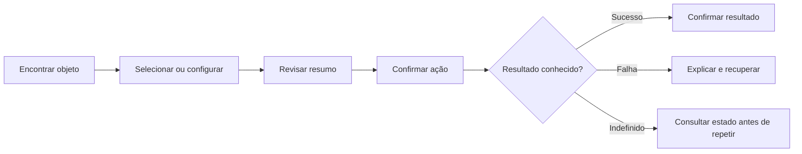

# Padrões de UX, conteúdo e adoção

Regras propostas para projetos novos. O design visual deriva das [evidências](EVIDENCE.md); os fluxos completos abaixo não foram executados na conta Yooga.

## 1. Escolher a composição pela tarefa

| Template | Quando usar | Estrutura | Mobile |
| --- | --- | --- | --- |
| Operação + contexto | Selecionar objetos e concluir uma ação | Busca/categorias → coleção → resumo lateral | Coleção + acesso persistente ao resumo; revisão em etapa/painel |
| Cadastro | Administrar entidades | Breadcrumb/título → superfície central → toolbar → tabela/grade | Lista ou tabela adaptada; criação em tela dedicada |
| Detalhe/edição | Consultar e alterar um objeto | Cabeçalho → grupos de campos → ações | Coluna única e ações acessíveis com teclado virtual |
| Visão geral | Acompanhar situação | Contexto/período → indicadores → detalhes → aprofundamento | Indicadores empilhados e filtros acessíveis |
| Hub de ajustes | Encontrar configurações | Perfil/contexto → grupos → cards de destinos | Lista agrupada ou grade curta |
| Editor | Manipular conteúdo espacial | Toolbar → canvas → propriedades → feedback | Canvas com comandos acessíveis e painel de propriedades recolhível |
| Jornada guiada | Tarefa longa com dependências | Etapas → conteúdo → revisão → resultado | Uma etapa por vez, retorno sem perda |
| Conteúdo institucional | Explicar proposta e orientar contato | Mensagem → benefícios → evidências → ação | Leitura linear; sem shell de sistema operacional |

O template institucional é extensão proposta. Ele herda identidade, mas não recebe automaticamente rail lateral ou cards de venda. Evitar transformar todos os produtos em um dashboard de caixas.

## 2. Fluxos reutilizáveis

### 2.1 Encontrar, filtrar e abrir

1. Mostrar a coleção com título e quantidade contextual.
2. Explicitar o escopo da busca e disponibilizar os filtros mais úteis.
3. Aplicar retorno local sem perder a consulta; ignorar respostas atrasadas de consultas anteriores.
4. Mostrar filtros ativos e recuperação de “sem resultados”.
5. Abrir o detalhe mantendo contexto de retorno.
6. Ao voltar, restaurar filtro, ordenação, posição e seleção quando coerente.

Separar quantidade total, filtrada e selecionada. “86 itens” não pode significar ora todos, ora apenas os carregados. URL pode guardar filtros compartilháveis, sem incluir dados sensíveis ou rascunhos privados.

### 2.2 Criar e editar

1. A ação nomeia a entidade: “Novo projeto”, “Nova categoria”.
2. Pedir primeiro os dados necessários à tarefa. Campos avançados aparecem agrupados.
3. Defaults são úteis e reversíveis; não inferir informação de negócio sem base.
4. Validar progressivamente e preservar a entrada.
5. Explicar a diferença entre cancelar, salvar rascunho e concluir, quando existirem.
6. Durante envio, impedir duplicação e manter contexto.
7. Em sucesso, confirmar o objeto e mostrar próximo passo pertinente.
8. Em falha, manter dados e oferecer correção/nova tentativa.

Autosave e salvar explícito não podem coexistir de forma ambígua. Se o produto usa autosave, mostrar “Salvando”, “Salvo” e “Falha ao salvar”; definir recuperação e conflito. Se usa salvar explícito, indicar alterações pendentes e saída sem salvar. Persistência é responsabilidade do produto, não uma promessa visual.

### 2.3 Selecionar, revisar e concluir

No PDV a revisão é uma venda; em outro produto pode ser exportação, agendamento ou publicação. O padrão é reutilizável; os critérios de conclusão e os dados não são.

Resultado indefinido após falha de conexão não equivale a falha confirmada. A interface deve informar “Verificando o resultado” ou estado equivalente antes de estimular repetição que possa duplicar a operação. O produto deve fornecer os mecanismos necessários.

### 2.4 Excluir e recuperar

Usar confirmação proporcional à consequência. Remover um item de um rascunho pode ter desfazer; excluir dado persistente sem recuperação exige contexto claro: objeto, quantidade e consequência. A ação principal do diálogo diz “Excluir categoria”, não “Confirmar”. Cancelar é fácil e recebe foco inicial seguro quando apropriado.

Não exigir confirmação em toda ação reversível. Não prometer desfazer se o produto não mantém a informação necessária. A disponibilidade e a duração da recuperação são explícitas.

### 2.5 Carregamento, erro e conexão

| Situação | Padrão |
| --- | --- |
| Carga inicial | Estrutura/skeleton ou indicador com contexto |
| Atualização de coleção | Preservar dados anteriores quando seguros, sinalizar atualização |
| Falha em um painel | Erro local; manter áreas independentes utilizáveis |
| Falha de validação | Mensagem no campo + resumo quando necessário |
| Sem conexão | Banner persistente e indicação do que ainda funciona |
| Sessão expirada | Explicar e orientar autenticação; preservar trabalho apenas se houver mecanismo seguro |
| Sem permissão | Nomear limitação e caminho de ajuda; não simular vazio |
| Dados conflitantes | Mostrar necessidade de atualizar/revisar antes de sobrescrever |
| Sucesso | Confirmar após resultado real, no contexto da ação |

Não exibir stack trace, código HTTP ou identificadores internos como mensagem principal. Um código de atendimento pode aparecer como informação secundária quando útil ao suporte.

## 3. Escrita de interface

Português brasileiro como baseline. Tom direto, humano e respeitoso. Evitar infantilização, excesso de exclamações e culpa. “Não foi possível salvar” é mais útil que “Você fez algo errado”.

| Contexto | Usar | Evitar |
| --- | --- | --- |
| Ação | “Salvar alterações” | “Enviar dados” sem objeto claro |
| Erro de campo | “Informe um nome para a categoria.” | “Campo inválido” |
| Sucesso | “Categoria criada.” | “Sucesso!” sem contexto |
| Busca vazia | “Nenhum resultado para ‘bebidas’.” | “Erro: nenhum item” |
| Dependência | “Adicione um item para continuar.” | Botão apagado sem explicação |
| Saída com edição | “Descartar alterações?” | “Tem certeza?” sem consequência |
| Espera | “Exportando imagem…” | “Aguarde…” indefinidamente |
| Falha recuperável | “Não foi possível carregar. Tente novamente.” | “Erro 500” como única mensagem |

Usar substantivos consistentes dentro do produto. Não alternar “item”, “registro” e “produto” para a mesma entidade sem motivo. Descrever atalhos apenas quando existirem. Ajuda aparece perto da decisão e pode ser expandida.

### Datas, números e unidades

- Moeda em pt-BR: `R$ 1.234,56`; respeitar moeda do produto quando houver internacionalização.
- Data curta `dd/mm/aaaa`; horário de 24 h; explicitar fuso quando isso muda uma decisão.
- Quantidade com plural correto: “1 categoria”, “6 categorias”.
- Distinguir não informado, zero, não aplicável e indisponível.
- Exibir unidade: px, cm, kg, min ou outra apropriada; não obrigar a inferi-la.
- Formatar com recursos de locale; não concatenar símbolos manualmente em cada componente.
- Para múltiplos idiomas, prever expansão de texto e layouts que não dependam de largura fixa da tradução.

## 4. Aplicação em diferentes projetos

| Projeto | Preservar da Yooga | Adaptar |
| --- | --- | --- |
| Sistema administrativo | Poppins, superfícies, tabela, ações suaves, breadcrumbs | Entidades, filtros e permissões |
| Editor de ambientes | Toolbar, painel contextual, seleção azul, feedback | Canvas, manipulação, zoom e histórico |
| Portal de clientes | Clareza, campos, cards e linguagem | Navegação mais curta e exposição de dados |
| Agenda | Tipografia, estados, filtros e revisão | Calendário, conflitos e fuso |
| Monitor operacional | Status redundante, cards e hierarquia | Densidade, atualização e legibilidade à distância |
| Aplicativo mobile | Identidade e componentes | Navegação, teclado, toque e etapas |
| Site institucional | Marca, fontes, forma e voz | Composição editorial e chamadas de contato |

Para o **Yooga Touch Draw**, uma futura adoção pode usar biblioteca de objetos como coleção, canvas como área principal e propriedades como painel contextual. Isso não altera o escopo atual nem autoriza adicionar persistência, zoom, desfazer ou novas ferramentas agora. Essas capacidades, se desejadas, precisam de tarefa própria.

## 5. Extensão de status de mesas

O CSS público declara os grupos abaixo. A existência dos nomes não comprova regras de transição de negócio.

| Chave de origem | Base | Escuro | Claro |
| --- | --- | --- | --- |
| `free` | `#818A8F` | `#242628` | `#E5E7E8` |
| `in-service` | `#7459C3` | `#4A377B` | `#E0DFF5` |
| `paid` | `#0A639A` | `#114769` | `#BDE3FA` |
| `paid-waiter` | `#D87739` | `#A54800` | `#FEDEC8` |
| `opened` | `#15A459` | `#145334` | `#BBF7D6` |
| `waiting` | `#EE467F` | `#841732` | `#FBCFE1` |
| `totem` | `#DDA706` | `#7A5C00` | `#FEF9E7` |

Manter essa paleta como extensão de domínio, sem contaminar os status globais do design system. Validar rótulos, contraste e significado com a equipe responsável antes de uso. Uma série de gráfico genérica não deve herdar o significado “pago” por usar o mesmo azul.

## 6. Critérios de qualidade

### Revisão de uma tela

- Existe uma tarefa principal e uma hierarquia de ações compreensível.
- A página comunica onde a pessoa está e como voltar.
- A composição usa um template e os componentes correspondentes.
- Textos, imagens e dados longos não quebram a estrutura.
- Estados vazio, sem resultado, loading, erro, sucesso e acesso restrito estão definidos quando aplicáveis.
- A cor tem significado estável; status têm texto.
- Controles funcionam por teclado, mouse e toque; foco permanece visível.
- O conteúdo se adapta a 320, 390, 768, 1024 e 1440 CSS px e a zoom; os pontos são cenários de teste, não novos breakpoints.
- Contraste é verificado nas combinações reais, incluindo hover, foco e mensagens.
- Alterações pendentes, ações destrutivas e falhas têm recuperação definida.
- Conteúdo confidencial não aparece em exemplos, fixtures ou screenshots compartilhados.

### Validação futura

Testar componentes isolados para estados significativos; fluxos integrados para tarefas críticas; comparação visual para regressões de layout; dispositivos reais para toque e teclado virtual. Ferramentas automáticas ajudam em contraste e semântica, mas não substituem uso com teclado/leitor de tela e revisão de linguagem.

Medir sucesso da tarefa, erros, recuperação, tempo até encontrar a ação e abandono onde adequado. Não inventar metas numéricas sem baseline. Revisões com pessoas que usam o produto devem verificar se a linguagem corresponde ao trabalho real.

## 7. Governança e evolução

Status desta versão: **proposta documentada**, pronta para revisão e para orientar implementação futura. Não é um manual oficialmente aprovado por todas as áreas da Yooga.

Papéis sugeridos: responsável de design mantém identidade e padrões; responsável técnico mantém componentes e tokens; responsável de produto valida semântica e tarefas. Esses papéis não foram atribuídos a pessoas nesta entrega.

### Processo de mudança

1. Registrar problema, exemplo concreto e contexto de uso.
2. Verificar se um componente existente resolve com variante adequada.
3. Propor mudança ou extensão com anatomia, estados, conteúdo e acessibilidade.
4. Validar o efeito em pelo menos dois contextos quando se pretende chamar algo de padrão transversal.
5. Documentar decisão, versão, impacto e migração.
6. Implementar somente no escopo autorizado e testar os fluxos afetados.

Versão major para mudança incompatível de contrato/token; minor para adição compatível; patch para correção sem mudar contrato. Depreciações devem indicar substituto e prazo decidido pela equipe. Não apagar tokens usados sem migração.

### Regra para exceções

Uma exceção precisa de motivo de tarefa, não apenas preferência estética. Registrar componente, contexto, alternativa considerada e critério para reavaliação. Se a mesma exceção se repetir, avaliar incorporá-la ao sistema.

### Caminho de adoção posterior

1. Validar esta referência visual e as decisões com o responsável pelo produto.
2. Adaptar os tokens para a tecnologia escolhida, sem vincular o núcleo a um framework específico.
3. Criar fundações e poucos componentes básicos com exemplos sintéticos.
4. Aplicar em um fluxo representativo e verificar identidade, acessibilidade e uso.
5. Migrar outras telas gradualmente, preservando comportamento e regras de negócio.

Esta entrega encerra-se na documentação. Nenhuma dessas etapas de implementação foi executada.
